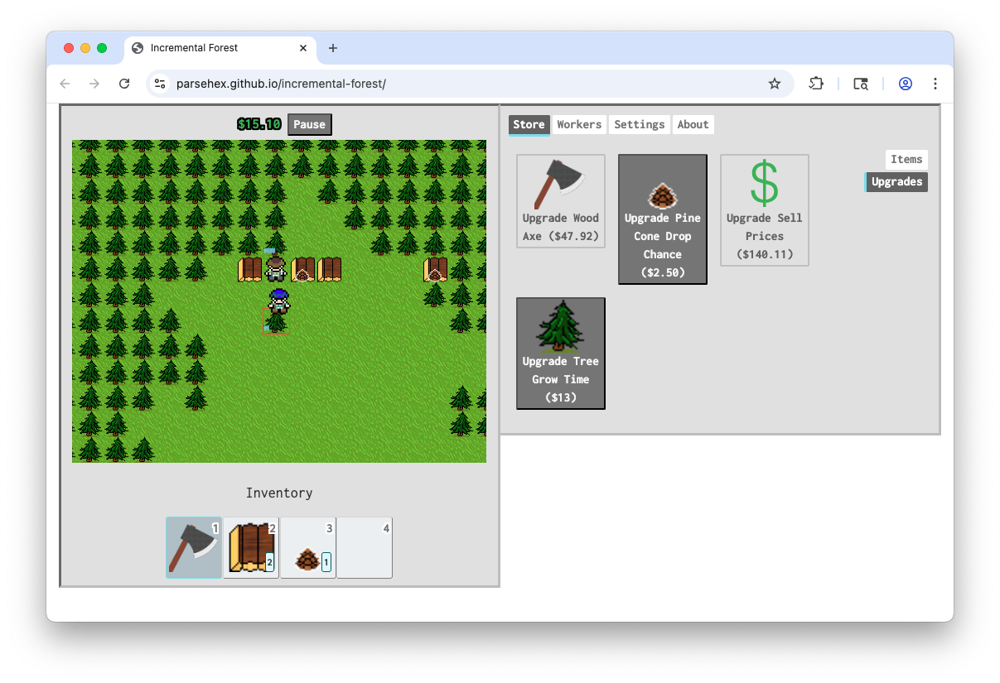
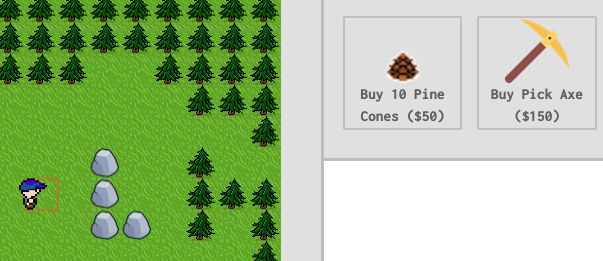

# Incremental Forest

This is an attempt to make an incremental game where you play as a character that is controlled with W/A/S/D keys. There's a simple game loop but you can hire NPC workers to help, which move around the map on their own.

> [!NOTE]
> **See any potential here? Let me know / Spread the word!**
>
> I've been restoring + refurbishing my projects but I need users and feedback. If you have any interest in using this project, please get in touch via the _**Issues**_ tab or one of the links under _**Sponsor this project**_ to the right. [My profile](https://github.com/parsehex) may have updated contact info.

This project was originally started from the [phaser-es6-webpack](https://github.com/lean/phaser-es6-webpack) boilerplate project by [lean](https://github.com/lean). Besides that, most of the project was written from scratch.

## New: **Rocks**

The default map now comes with 4 boulders which can be chopped using the Pick Axe, giving you Rocks that you can sell.

## License

This project is licensed under MIT.

Some art has been used from the following places:

- <https://craftpix.net/freebies/free-simple-summer-top-down-vector-tileset/?num=2&count=93&sq=simple&pos=10>
- <https://www.svgrepo.com/svg/275512/pickaxe>
